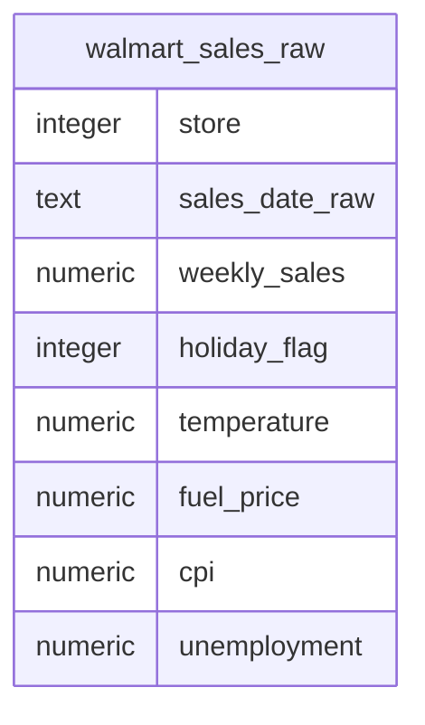

# Walmart · Продажи в праздничные недели

SQL-анализ недельной выручки 45 магазинов Walmart за 2010–2012 годы. **Самый заметный общий пик пришёлся на конец ноября.** В 2010 году в эту неделю 41 магазин превысил свой обычный уровень продаж, в 2011 году — 43. Особенно выделился магазин № 35, где выручка за неделю более чем удвоилась в оба года.

## Бизнес-проблема

Перед праздниками сети нужно планировать поставки и смены сотрудников. Единый план для всех магазинов может привести к дефициту в одних точках и лишним запасам в других. **В какие недели и в каких магазинах продажи растут достаточно заметно и регулярно, чтобы заранее пересмотреть план?**

## Данные и ER-диаграмма

Файл данных — `walmart-sales-dataset-of-45stores.csv`. Одна строка описывает продажи одного магазина за одну неделю. Данные охватывают 143 недели с 5 февраля 2010 года по 26 октября 2012 года. Анализ выполнен в PostgreSQL с помощью pgAdmin.

В проекте одна таблица. Магазин и дата вместе определяют наблюдение. Поле `holiday_flag` принимает значение 1 для праздничной недели и 0 для обычной. Перед сортировкой текстовую дату преобразуем через `TO_DATE(sales_date_raw, 'DD-MM-YYYY')`.

## Результаты анализа

### 1. Какие магазины лидируют по общей выручке?

| Магазин | Выручка за весь период |
|---|---:|
| 20 | 301 397 792,46 |
| 4 | 299 543 953,38 |
| 14 | 288 999 911,34 |

### 2. Как отличаются праздничные недели у лидера продаж?

У магазина № 20 средняя выручка за 133 обычные недели составила **2 097 048,43**, а за 10 праздничных — **2 249 035,08**. Это прибавка примерно **152 тыс.** за праздничную неделю в среднем.

### 3. Где праздничная прибавка больше всего?

Для каждого магазина рассчитаны две средние недельные выручки. Абсолютная прибавка равна разности праздничной и обычной средних. Для процентной прибавки эта разность делится на обычную среднюю.

| Место | Магазин по абсолютной прибавке | Прибавка | Магазин по процентной прибавке | Прибавка, % |
|---:|---:|---:|---:|---:|
| 1 | 10 | 230 446,52 | 7 | 19,44 |
| 2 | 28 | 166 355,62 | 35 | 18,31 |
| 3 | 35 | 166 249,30 | 15 | 14,48 |
| 4 | 2 | 165 058,09 | 5 | 14,17 |
| 5 | 4 | 159 546,78 | 12 | 13,89 |

Магазин № 10 даёт самую крупную прибавку в деньгах. У № 7 продажи сильнее всего меняются относительно привычного для него уровня. Магазин № 35 попадает в первую тройку по обоим показателям.

### 4. Как часто продажи превышают обычный уровень?

В качестве базы берём среднюю выручку обычной недели **того же магазина**. Затем считаем, сколько из 10 праздничных недель превысили эту базу.

| Магазины | Недель выше базы | Доля |
|---|---:|---:|
| 24, 26, 43 | 8 из 10 | 80 % |
| 35 | 6 из 10 | 60 % |
| 25, 32 | 2 из 10 | 20 % |

Даже при средней праздничной прибавке 18,31 % магазин № 35 превысил базу лишь в шести случаях. Для планирования важно знать, на какие даты пришлись пики.

### 5. В какие недели рост охватывал почти всю сеть?

Для каждой даты считаем магазины, чья выручка превысила их собственную базу. В каждой строке представлены все 45 магазинов.

| Праздничная неделя | Магазинов выше базы в 2010 | В 2011 | В 2012 |
|---|---:|---:|---:|
| Февральская | 28 | 24 | 35 |
| Сентябрьская | 15 | 18 | 30 |
| Ноябрьская | 41 | 43 | — |
| Конец декабря | 2 | 16 | — |

Прочерки означают, что период наблюдений закончился в октябре 2012 года. Самый большой охват наблюдался в недели 26 ноября 2010 года и 25 ноября 2011 года.

### 6. Насколько резко выросли продажи в конце ноября?

Здесь база сравнения — **предыдущая неделя того же магазина**. Функция `LAG(weekly_sales)` берёт предыдущее наблюдение внутри `PARTITION BY store` в порядке дат. Фильтр по праздничной дате применяется после этого расчёта.

Пять магазинов с наибольшим ростом за неделю к 25 ноября 2011 года:

| Магазин | 18 ноября | 25 ноября | Изменение за неделю |
|---:|---:|---:|---:|
| 35 | 820 964,10 | 1 733 822,40 | +111,19 % |
| 29 | 504 601,29 | 913 165,19 | +80,97 % |
| 15 | 597 856,51 | 1 066 478,10 | +78,38 % |
| 7 | 539 826,56 | 949 075,87 | +75,81 % |
| 21 | 737 014,09 | 1 219 263,40 | +65,43 % |

Годом ранее магазин № 35 показал похожую динамику. С 19 по 26 ноября 2010 года продажи выросли с **846 850,35** до **1 781 866,98** (+110,41 %).

## Что делать с результатами

- **Перед концом ноября** пересматривать план поставок по сети. Начать с магазина № 35, где резкий рост повторился два года подряд.
- **Для магазина № 10** проверить, хватит ли запасов на крупную прибавку продаж. **Для № 7** проверить, сможет ли магазин обслужить высокий спрос относительно своей обычной нагрузки.
- **При планировании смен** сопоставить недели пиков с внутренними данными о числе покупок и загрузке персонала. Недельная выручка помогает выбрать магазины для проверки. Для расчёта количества сотрудников и объёма заказа потребуются данные по часам, товарам и остаткам.
